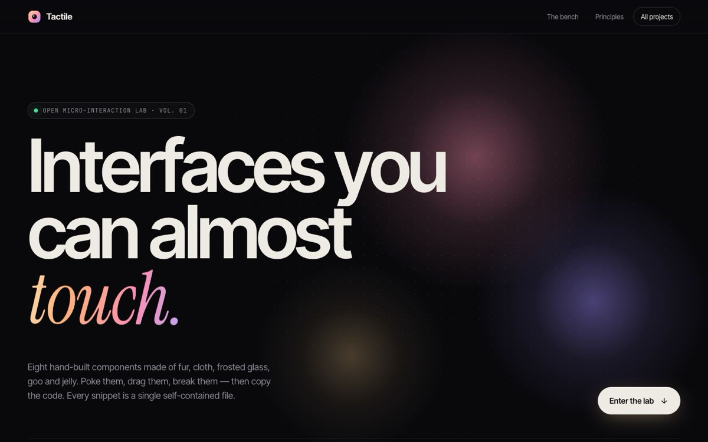

# Tactile — UI Micro-interaction Lab

[](https://tabishhassan5121472.github.io/tactile-ui-lab/)


Interfaces you can almost touch: a dark gallery of eight hand-built micro-interactions (fur, cloth, glass, goo, jelly), each with a one-click "Copy code" snippet.

**Live demo:** [https://tabishhassan5121472.github.io/tactile-ui-lab/](https://tabishhassan5121472.github.io/tactile-ui-lab/)

## Components
1. **Fluffy button**: about 1,800 canvas hair strands with spring physics that lean with cursor velocity, ruffle on hover and burst on release.
2. **Fabric button**: animated `feTurbulence` + `feDisplacementMap` cloth ripple with `feDiffuseLighting` fold shading.
3. **Glassy OTP**: frosted card over golden SVG waves; supports auto-advance, paste, backspace and arrow keys. On verify the digits scatter, a spinner runs, then a success ring and checkmark draw in.
4. **Glassy 3D carousel**: CSS 3D coverflow of code-drawn SVG posters. Drag with momentum and rubber-band edges, or use the keyboard; a glass panel shows the active poster's details.
5. **Magnetic button**: cursor pull with elastic snap-back.
6. **Liquid toggle**: gooey SVG filter with trailing droplets.
7. **Jelly checkbox**: squash-and-stretch with a drawn tick.
8. **Text links**: scramble, letter roll, hover split.

## Techniques
GSAP 3.12.5 + ScrollTrigger, Canvas 2D, SVG filters, CSS 3D transforms, `backdrop-filter`, a cursor spotlight shared across the grid, IntersectionObserver to pause loops when offscreen, and `prefers-reduced-motion` support. There is no build step and every visual is drawn in code.


## Run locally

```bash
npx serve .
```

## License

MIT — free to learn from and reuse.
